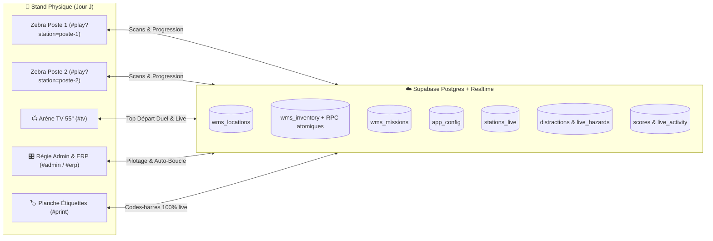

<div align="center">

# 📦 GT Logistics • WMS Shift Challenge (Édition 25 Ans)

**Application web événementielle & industrielle de gamification logistique en temps réel**  
*Duels 2 Terminaux Zebra • Arène TV 55" • ERP Stock Atomique • Boucle Physique Auto-Équilibrée • 100 % Supabase Realtime*

[](https://react.dev)
[](https://www.typescriptlang.org)
[](https://vitejs.dev)
[](https://tailwindcss.com)
[](https://supabase.com)
[](https://vercel.com)

</div>

---

## 🎯 Vision du Projet

Conçue pour les **25 ans de GT Logistics**, cette application transforme une véritable opération de logistique industrielle (picking, contrôle de traçabilité, réintégration en stock, gestion d'aléas) en une **expérience arcade compétitive en binôme (Collaborateur GT + Invité)**.

### Principes d'Architecture
- **Zéro donnée métier codée en dur** : emplacements, stocks, missions, aléas, règles et Ticket d'Or vivent **100 % dans Supabase**.
- **Synchronisation Temps Réel intégrale (9/9 tables)** : toute modification dans l'Admin, l'ERP ou le dashboard Supabase se répercute instantanément sur les 2 Zebra, la TV 55", le Podium et la Planche d'Étiquettes.
- **Boucle Physique Auto-Équilibrée** : les joueurs rangent eux-mêmes le stand en alternant **Livraison (`Bac -1 → Table +1`)** et **Collecte (`Table -1 → Bac +1`)**, permettant à l'organisateur de rester **100 % animateur**.

---

## 🏗️ Architecture Temps Réel



---

## ✨ Fonctionnalités Clés

| Module | Route | Rôle & Points Forts |
| :--- | :--- | :--- |
| **🏠 Lanceur Multi-Écrans** | `#home` | Point d'entrée rapide pour lancer un Duel, un Solo, l'Arène TV, l'Admin ou la Planche d'Étiquettes. |
| **📱 Mode Pur Zebra** | `#play?station=poste-1` | Interface tactile épurée verrouillée gameplay : anti-double-scan matériel (`< 250ms`), anti-rebond gâchette (`< 800ms`), vibration & sirène sur Aléas Flash, résilience Wi-Fi + `sessionStorage`, modal **« Prochain Duo »** pour enchaîner sans quitter la Zebra. |
| **📺 Arène TV 55"** | `#tv` | Affichage e-sport temps réel des 2 binômes (Bleu vs Orange), barres de progression, Top Départ Duel synchronisé sur les 2 Zebra, fil d'activité live et remise de diplômes. |
| **🎛️ Régie Admin & Coach Jour J** | `#admin` | **Assistant Régie dynamique** qui indique quoi positionner physiquement sur le stand, vérifie la cohérence BDD en temps réel, génère la **Boucle Auto-Équilibrée** en 1 clic, édite missions/stock/emplacements/aliases et déclenche les Aléas Flash. |
| **📦 Stock & ERP Traçabilité** | `#erp` | Édition en ligne de toutes les références, suivi atomique `quantity` (en bac) + badge live **`📦 Sur Table : X`** (`on_table_qty`), et bouton **Remise à Niveau Physique** (`reset_wms_inventory_to_nominal`). |
| **🏷️ Planche d'Étiquettes** | `#print` | Génération dynamique de codes-barres Code128 (format rouleau thermique Zebra 100×50 / 100×38 / 76×51 / 50×30 / 102×152 mm ou planche A4) 100 % issus de Supabase, incluant le **Ticket d'Or**. |
| **🏆 Podium & Diplôme** | `#podium` | Classement dédupliqué (meilleur score par binôme), export CSV, vrai temps écoulé (`mm:ss`), précision réelle et génération de **Diplôme d'Honneur** imprimable. |

---

## 🔄 La Boucle Logistique Auto-Équilibrée (Zéro Rangement)

Chaque produit dans `wms_inventory` suit **2 compteurs atomiques** via la fonction SQL `move_wms_stock_loop(p_item_id, p_direction)` :

1. **📤 Mission Livraison (`stock_direction = 'out'`)** : le Duo prélève en bac et dépose sur la **Table de Livraison** → `Bac -1` / `Table +1`.
2. **📥 Mission Collecte (`stock_direction = 'in'`)** : le Duo récupère sur la **Table de Collecte** et range dans son bac d'origine → `Table -1` / `Bac +1`.
3. **🔄 Mission Manutention (`stock_direction = 'none'`)** : déplacement de colis sans impact sur le stock.

> **Partitionnement anti-collision** : le générateur **⚡ Auto-Boucle** répartit les articles en **Lot A** et **Lot B** pour que Poste 1 et Poste 2 ne se croisent jamais devant le même bac.

---

## 🗄️ Schéma Base de Données Supabase (9 Tables Realtime)

| Table | Rôle | Realtime |
| :--- | :--- | :---: |
| `public.wms_locations` | Emplacements physiques (`barcode`, `label`, `lr_code`, `cr_label`, `zone`, `aliases[]`) | ✅ |
| `public.wms_inventory` | Stock articles (`sku`, `name`, `location_barcode`, `quantity`, `nominal_quantity`, `on_table_qty`, `critical`, `aliases[]`) | ✅ |
| `public.wms_missions` | Scénarios de missions (`code`, `title`, `steps` JSONB, `stock_direction`, `base_points`, `time_limit_seconds`) | ✅ |
| `public.app_config` | Configuration globale (`event_title`, `shift_duration_seconds`, `strict_scan_only`, `golden_ticket_barcode`, `delivery_table_barcode`, `collect_table_barcode`) | ✅ |
| `public.stations_live` | État live Poste 1 / Poste 2 (binôme, mission assignée, étape, score, combo, statut) | ✅ |
| `public.distractions` | Catalogue des modèles d'Aléas Flash | ✅ |
| `public.live_hazards` | Aléas Flash actifs en cours de partie (`all`, `poste-1`, `poste-2`) | ✅ |
| `public.scores` | Classement Podium & historique des meilleures performances | ✅ |
| `public.live_activity` | Journal temps réel des scans affiché sur l'Arène TV | ✅ |

**Fonctions SQL atomiques (`SECURITY INVOKER`) :**
- `adjust_wms_inventory_quantity(p_item_id, p_delta)` — ajustement unitaire sans écrasement concurrent.
- `move_wms_stock_loop(p_item_id, p_direction)` — transfert atomique `Bac ↔ Table`.
- `reset_wms_inventory_to_nominal()` — remise au stock nominal (`quantity = nominal_quantity`, `on_table_qty = 0`).

---

## 🚀 Installation & Démarrage Rapide

### 1. Prérequis
- **Node.js** `>= 18`
- Un projet **Supabase** avec les tables ci-dessus et **Realtime** activé.

### 2. Configuration `.env`
Créez un fichier `.env` à la racine du projet :

```env
VITE_SUPABASE_URL=https://<votre-projet>.supabase.co
VITE_SUPABASE_ANON_KEY=<votre-cle-anon-publique>
```

### 3. Lancer en local ou compiler

```bash
# Installer les dépendances
npm install

# Démarrer le serveur de développement
npm run dev

# Vérifier TypeScript + build de production
npm run build
```

---

## 📋 Checklist Animateur — Jour J (2 Décembre)

1. **Ouvrir `#admin`** et consulter l'**Assistant Régie** en haut de page.
2. Vérifier que les **tables Livraison & Collecte** sont configurées dans *Règles* et cliquer sur **« 📦 Je les pose sur la table (Sync ERP) »** pour amorcer 2 pièces sur la Table de Collecte.
3. Cliquer sur **« ⚡ Générer / Actualiser Boucle Auto »** pour aligner 100 % des missions sur vos vrais bacs et passer le contrôleur au **vert ✅**.
4. Activer **« 🔒 Mode Compétition Jour J »** (`strict_scan_only`) pour verrouiller les scans réels uniquement.
5. Ouvrir **`#tv`** sur l'écran 55", **`#play?station=poste-1`** sur la Zebra A et **`#play?station=poste-2`** sur la Zebra B (via les QR Codes générés dans l'Admin).
6. **Animer et profiter !** Entre deux duos, enchaînez soit depuis le **Top Départ TV**, soit directement depuis le bouton **« Prochain Duo »** sur chaque Zebra.

---

<div align="center">
  <sub>Développé pour les <strong>25 Ans GT Logistics</strong> • Architecture 100 % Data-Driven & Temps Réel</sub>
</div>
